# 9. Viewing results

Estimation leaves you with a single `.psyrat` file. Everything in this chapter
reads that file back and turns it into figures and tables. Nothing here
re-estimates anything. You can reopen the same results file as often as you
like, try a different reliability threshold, save a table, and close the windows
again without disturbing the fit.

If you have not run an analysis yet, [Chapter 7](07_processing.md) covers
processing, and [Chapter 2](02_quick-start.md) walks the shortest path from raw
data to a first set of results.

## 9.1 What every viewer has in common

### Opening a results file

Selecting View Results on the home screen brings up a file picker titled Data,
filtered to PsyRAT files (\*.psyrat). Choose the file you want. If you
cancel the picker instead, the toolbox reopens the home screen and shows a File
Error dialog saying that no PsyRAT results file was selected. That is a
notification, not a failure, and clicking View Results again picks up where you
left off.

Loading prints a short `Loading Data...` line in the MATLAB Command Window,
then opens one of five setup screens.

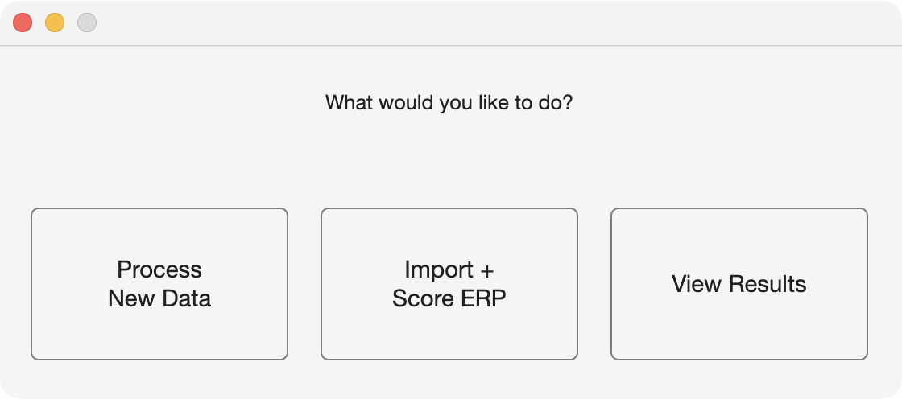

### Which viewer opens, and why you do not choose it

The results file records the design that produced it, and the toolbox routes on
that record. Five viewers exist, one per analysis family:

- Single-session (one-facet) results open View Results Setup.
- Test-retest (two-facet) results open View Results Setup, with extra controls.
- Difference-of-differences results open DoD Reliability Setup.
- Dynamic reliability results open Dynamic Reliability: View Results.
- Nonparallel data-splits results open Data-Splits Reliability: View Results.

The routing is not a preference and no control overrides it. A difference-score
result opens the single-session viewer because a difference score in a single
session is a one-facet design, not because anything guessed. If a results file
carries a design label the toolbox does not recognize, no viewer opens at all
and you are returned to a bare prompt, which happens only with a file written
by a different version or edited by hand. One route does cross families on
purpose: the DoD viewer can build a single-event or two-event view out of a DoD
model and hand it to the single-session viewer
([Section 9.4](#94-difference-of-differences-results)).

Parallel data splits are a separate case. They reuse the single-session and
test-retest viewers, with every trial-labeled control relabeled to split (Plot:
Splits vs Reliability, Table: Split Cutoffs at Reliability Threshold, and so
on). Only nonparallel splits get their own viewer.
[Chapter 13](13_tutorial-splits.md) explains the difference between the two.

### Two notices that may appear before the viewer does

Some results files raise a warning dialog on open. Dismiss it and the viewer
opens.

The first is titled Native estimation engine. It appears when the fit came from
a native MATLAB engine rather than CmdStan, and its wording depends on which
one. A native HMC (Hamiltonian Monte Carlo) fit is described as genuine
Bayesian posterior draws that are not bit-identical to a CmdStan run. A native `fitlme` fit is described more
sharply, because its intervals are approximate frequentist intervals rather than
Bayesian credible intervals; that notice also reports, for each fit, how many
bootstrap replicates succeeded of the number requested and how many failed
refits were dropped, and says when the original REML fit failed its validity
check. Both wordings state that final-inference readiness is unassessed. A CmdStan run also requires diagnostic and uncertainty validation;
switching engines does not establish readiness. Use the native engines to get a
pipeline working. The reporting workflow remains CmdStan, with those validation
requirements.

The second is titled Estimation diagnostics, and it appears for every result
that carries a convergence record, clean CmdStan runs included. It always opens
with the scope of the check (the early-workflow R-hat and effective-sample-size
screen, or the REML validity and bootstrap-count check on a native fitlme
result) and a line saying that final-inference readiness is unassessed, then
the source and precision of the diagnostics it read. On a clean run that is all
it says, it opens beside the setup screen, and it does not block. It blocks
when there is something to acknowledge: a failed check, one or more divergent
transitions, parameters recorded as excluded from the check (constants such as
correlation-matrix diagonals, listed by name), or diagnostics read from a
degraded summary (the two-significant-figure printed fallback, or a CmdStan
before 2.33 that reports a single effective sample size). Non-convergence means
at least one measurement failed the R-hat and effective-sample-size criteria.
Divergences are reported independently of that verdict, because sampling can
diverge on a fit whose R-hat looks fine. In both cases the fix is another run
with more warmup and sampling iterations, and sometimes stronger priors. On a
native fitlme result the check is different: the original REML fit must pass
its validity check, and enough bootstrap replicates must succeed. That notice
asks you to inspect the per-fit optimizer warnings, invalid estimates, and
refit counts, and more iterations do not help there, because fitlme does not
use them. [Chapter 18](18_troubleshooting.md) covers the diagnostics.

The Native estimation engine notice and a blocking Estimation diagnostics
notice wait for the click before the viewer is drawn, which is deliberate: a
warning drawn first would be covered by the setup screen a fraction of a second
later and never read. The side effect is that MATLAB can look hung while a
notice waits, especially if the dialog opened behind another window. If the
toolbox appears frozen just after you selected a `.psyrat` file, look for a
warning dialog before you reach for Ctrl+C.

Neither blocking notice appears for a clean CmdStan run, and no notice at all
appears for a result saved before the convergence record existed. Silence on
open means there was nothing recorded, not that nothing was checked.

### View Preferences

The Output Prefs button on the single-session and test-retest screens opens
View Preferences. Four rows, then Save and Back:

- Line to plot for reliability: which of the three posterior summaries is drawn
  as the curve in the reliability-versus-trials figure. The choices are Lower
  Limit, Point Estimate, and Upper Limit.
- Number of trials to plot: how far the x-axis of that figure extends.
- Estimate to use for trial cutoffs: which posterior summary is compared
  against the Reliability Cutoff when the toolbox searches for the trial count
  that meets your threshold. Same three choices.
- Measure of central tendency for overall reliability calculations: Mean or
  Median.

The defaults are Point Estimate, 50, Point Estimate, and Mean. Each of the
three lists must have one option selected: a Cmd or Ctrl click that clears a
selection is refused at Save with a dialog naming the list (Plot Line Not
Defined, Cutoff Estimate Not Defined, or Central Tendency Not Defined), and the
previous choice is put back. The cutoff
estimate is the one to think about. Choosing Lower Limit there is the
conservative reading, since it requires the whole credible interval to clear
your threshold, and it will generally demand more trials than the point estimate
does. That is a defensible choice and I use it when a decision hangs on the
result. It is also a different estimand, so say in your methods which one you
used. Fifty trials, meanwhile, is a plotting range and not a claim about your
data. If your task delivers 200 usable trials, raise it, or the curve will stop
before it reaches the part you care about.

On a result from the native fitlme engine the limits are those of a
parametric-bootstrap interval, not a credible interval. The tooltips, figure
titles, and export headers of such a result say bootstrap interval rather than
credible interval, and "credible interval" in this chapter means that interval
for it.

To save the preferences click Save. To leave them as they were click Back.
Either way you land back on the setup screen. Entering fewer than two trials to
plot raises a dialog titled Invalid plot trial count and keeps you here, because
a one-point curve is not a curve.

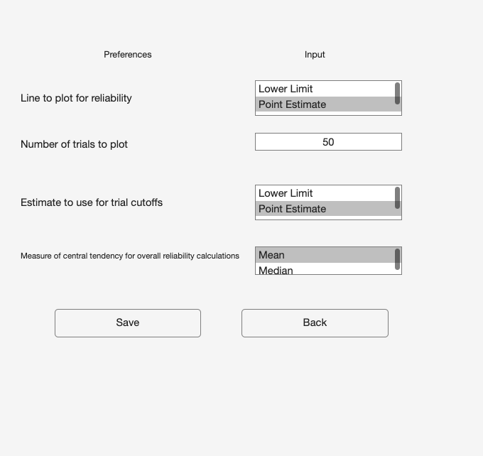

### Table windows and what a saved table carries

Every table the single-session, test-retest, criterion, and DoD viewers draw
opens in its own window with a save button at the bottom, usually labeled Save
Table. Two windows differ. On a subject-level run the window that Table:
Subject-Level Reliability opens carries Save Group-Level Estimates and Save
Subject Coefficients instead, and the DoD Reliability Outputs window has no
export button at all ([Section 9.4](#94-difference-of-differences-results)).
Canceling a save dialog writes nothing and says nothing. Apart from the three
exports described next, the dialog offers Excel File (.xlsx) and
Comma-Separated Value File (.csv), and both write on every platform. A name
whose extension is neither .xlsx nor .csv (in uppercase or lowercase) is
refused with an Unsupported File Type dialog, and nothing is written. The
dynamic-reliability and data-splits table windows carry no Save button of
their own; you export those tables from the Save buttons on their setup
screens. Those buttons write a checked workbook for a name ending in .xlsx and
CSV text under any other name, so give the file a .csv extension yourself.

Three exports behave differently. The criterion table's Save Table writes a
workbook for a name ending in .xlsx and a CSV file for any other name. The Save
Table button of the window that View All Standard Deviations opens on a
one-facet difference-score run, and the Save Subject Coefficients button of a
subject-level run ([Chapter 15](15_advanced-designs.md)), offer and write CSV
only.
Whenever one of these three writes CSV under a name that does not end in .csv,
it adds .csv to that name. The save dialog never showed that longer name, so if a file with it
already exists, a Replace Existing File? question names that file, and Cancel
writes nothing. A name that is an existing folder is refused. These three
exports write a temporary file in the same folder first (psyrat_partial_1.csv,
or the next free number) and move it onto the chosen name only after it has
been written and closed without a reported error. If the export fails before that
move, a File Not Saved dialog says whether the temporary file was removed, and
no existing file is replaced. If the move itself fails, the dialog says that the
new file could not replace the old one; check that file before relying on it.

Every .xlsx save from the viewers, including Save IDs, the criterion table, and
the Save buttons of the dynamic-reliability and data-splits screens, replaces
the chosen file with a new, checked workbook rather than writing into it. The
table goes first to a new workbook in the same folder (psyrat_stage_1.xlsx, or
the next free number), which is read back: it must have one sheet holding
exactly the cells the export intended, in their places. A file already under
the chosen name is copied (psyrat_backup_1.xlsx, or the next free number), and
the copy is checked byte for byte before the new workbook is moved onto the
name; the file is read back after the move. If the move fails or leaves
anything but the checked workbook, the original is put back from its copy and
checked again, and if that fails too, the copy is kept and the dialog names it.
Because the old file is replaced, rows, columns, and worksheets it held beyond
the new table do not survive. A name that is an existing folder is refused, and
Cancel writes nothing. A File Not Saved dialog says what happened to the chosen
file and names any temporary file left behind; if a save succeeds but a
temporary file cannot be removed, a warning names it and the save stands. The
replacement is not atomic: it does not keep the old file's permissions or
other file-system metadata, and it cannot protect a save interrupted by a crash
or power failure. A table that an earlier version of PsyRAT saved as .xlsx over
an existing workbook can still hold such leftover cells; export it again from
the saved result (no refit is needed).

Two limits can stop an .xlsx save; the file already under the name is then
left as it was. First, an Excel cell holds at most 32,767 characters, and longer
text is refused rather than cut; the design lines of a multi-occasion
data-splits export can exceed that ([Section 9.6](#96-data-splits-results)).
Second, the check reads the
workbook back with a reader that cannot confirm some text. A carriage return is
refused before anything is written, because the workbook writer PsyRAT uses
stores it in a form that standard readers return as a line feed. Control characters other than tab and line feed,
literal text of the form `_xHHHH_` (a lowercase x and four hexadecimal digits
between underscores), characters beyond the Basic Multilingual Plane such as emoji, and
a few other rare characters are refused as well. A workbook can store most of
them, but this check cannot confirm that they would read back unchanged. Tabs, line feeds,
leading and trailing spaces, and ordinary characters, accented and non-Latin
letters included, save exactly. Numbers are compared exactly; a NaN is written
as an empty cell, and an infinite value is refused rather than
written as a large number. Long design lines and text with line breaks can be
saved as .csv instead. For other refused text you can try .csv, but check the
exported text before relying on it.

Above the table itself, a saved file carries a header block. The table-specific
part records when the table was generated, the toolbox version, and the dataset
file name; the trial-cutoff and overall-summary exports add the reliability
cutoff you set (to four decimal places, since the cutoff is an input you may
need to reproduce exactly), which posterior summary the cutoff was applied to,
and the warmup and sampling iterations of the run.

Under that comes a standard provenance block, written by the same routine for
every export. It records the estimation seed, the analysis design label, the
estimation engine, the interval width the summary was built at, whether the
priors were the toolbox defaults or customized, the early-workflow check
verdict followed by the line that final-inference readiness is unassessed and
by one line per fit naming the source and precision of its diagnostics, the
divergent-transition count, and, when any were recorded, the parameters
excluded from the check. A native fitlme export says so in its own terms: its
priors line reads that priors were not used, an Interval method line names
the parametric bootstrap, its width line reads Bootstrap interval, and it adds
a line per fit giving the bootstrap replicates that succeeded of the number
requested. Designs that need more get more: a test-retest export names which of the three coefficients
produced the numbers, a non-Gaussian likelihood is labeled, and the designs with
unusual estimands carry a sentence saying so. Anything the file does not record
is written as "not recorded" or "not assessed" rather than guessed, so an old
results file still exports and its header is never fabricated.

The block exists so a saved table can be interpreted a year later without the
session that produced it. Keep the header when you circulate a table. Stripping
it leaves a column of coefficients with no design attached.

### Save IDs, and what it decides for you

The overall summary window (titled Dependability Analyses or Generalizability
Analyses after the coefficient you selected, with Including All Trials and the
occasion estimand appended on the test-retest viewer) carries a second button,
Save IDs, next to Save Table. Its first two columns are Good IDs and Bad IDs,
listing participants whose data met your reliability threshold and those whose
data did not. Two further columns, Good Group and Bad Group, preserve group
membership when an ID is reused across groups. A run without groups writes
`none` in those columns, and a participant literally named `none` is still an
ID. The same file formats are offered. On the test-retest viewer with Stability or Equivalence + Stability
selected, the window carries a third button, Estimate New Reliability
Coefficient. It opens a window titled Specify Inputs, where you enter a trial
count and get the coefficient at that count, which is useful when no cutoff
reached your threshold and you want the reliability your trials do deliver.

Two behaviors are worth knowing before you use that list.

The first is the all-events inclusion rule for ordinary and group-level
difference summaries. Each group has its own observed roster: the union of IDs
observed across the required events. When a group has more than one event, a
participant reaches the Good IDs column only by meeting the threshold in every
event, and everyone else on that roster goes to Bad IDs. Falling short in one
event is enough to move a participant into Bad IDs for the whole group, even
where their data in the other events were fine.

If no participant clears the threshold in some event, that group's Good IDs
column is empty. The MATLAB Command Window prints a line saying so, the
group's n Included reads 0, and the summary still opens, so the per-event rows
stay available for diagnosis. Those per-event rows show dashes in their
coefficient and trial-summary cells, with numeric n Included and n Excluded. A
group-level difference coefficient is still reported for such a group: it is
evaluated at the full sample's mean (or median, per the central-tendency
choice) trial counts and labeled as a full-sample reference. The test-retest
difference route uses the full sample's counts at every retention level and
labels them the same way. The saved summary keeps the underlying values and
which population each one describes. None of this changes the subject-level
difference-score qualification counts, and on the single-session group-level
difference route the common difference-score cutoff is a decision-study
(D-study) projection that does not re-filter the roster.

Consider this example: a flanker analysis with error and correct trials, where
a participant has 90 correct trials and 4 errors. The correct
condition clears the threshold comfortably and the error condition does not, so
the participant appears once, in Bad IDs. That is the right default for an
analysis that uses both conditions, including any difference between them. It
is the wrong default if you meant to screen each condition on its own, and the
per-event lists are not what Save IDs writes.

The second is the -1 sentinel, which you will meet in the trial-cutoff table
(the window titled Results of Increasing the Number of Trials on Dependability,
or on Generalizability, after the coefficient you selected) rather than in the
ID file. When no trial count in the projected range reaches
your threshold for an event, the toolbox stores -1 for that cutoff and for the
coefficient and interval at it. It is a flag, not a count, and averaging it
into anything produces nonsense. Because no evaluated trial count qualified
anyone for that event, every participant in that event's group lands in Bad
IDs. A dialog titled Cutoff not calculable says the data are too variable or
there are not enough trials. Lower the threshold, or accept that these scores
do not support the decision you wanted to make with them. (On a single-session
difference-score run, a common difference cutoff that cannot be found leaves
the per-event roster as it is, and the difference row keeps its reference
coefficient and interval.)

A related dialog, Extrapolation beyond data, means the opposite problem: a
cutoff was found, but only past the largest trial count observed for that
group and event in the original data, before any retention. The cutoff and its
coefficient stay numeric, and the coefficient carries the suffix "(projection
beyond observed data)": it is a model projection, not a retained-sample
estimate. A file summarized by an earlier version can still show -1 in those
cells; open it with View Results and click Generate Figures/Tables, which
rebuilds the summary from the saved draws.

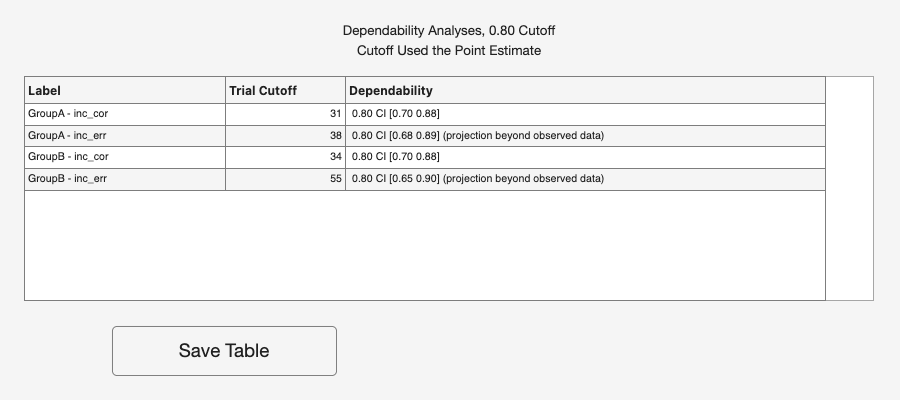

Note one asymmetry. Save Table writes the full provenance block. Save IDs
writes the shorter header (generation date, version, dataset, cutoff, cutoff
estimate, and the iteration line) without it. If you archive an ID list, archive
the summary table alongside it.

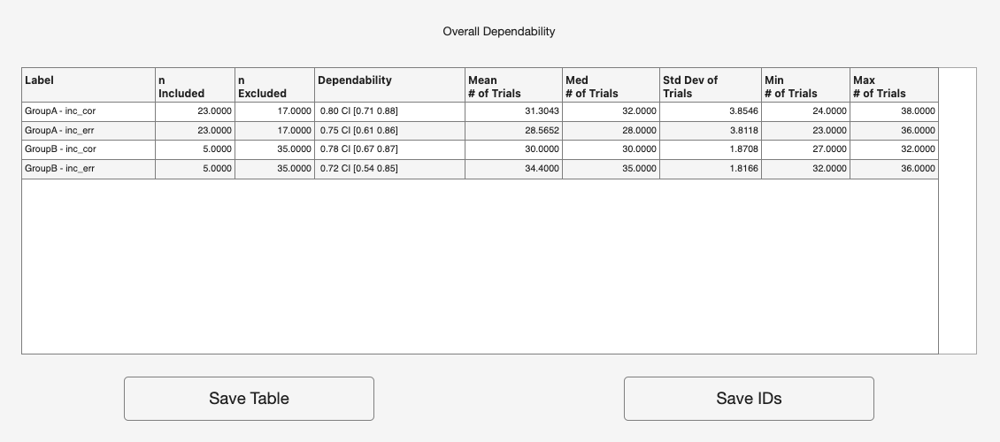

## 9.2 Single-session results

The one-facet viewer is titled View Results Setup. Its top rows are read-only:
Dataset, Measurement, and, when the analysis is not a difference score and
covers exactly one event, Cell/Event.

Two settings sit above the checkboxes.

- Reliability Cutoff: the reliability threshold used to retain data.
  Participants without enough trials to meet it are recommended for exclusion.
  The default is .8.
- G-Theory Coefficient: which coefficient the outputs report. Dependability
  uses absolute error variance, and generalizability uses relative error
  variance.

The .8 default is conventional rather than derived, and I would not defend it as
a universal standard. Pick the threshold your decision needs and state it.

The coefficient control changes with the design. On a plain one-facet run and on
a subject-level run the label reads G-Theory Coefficient; on a subject-level run
its tooltip names the absolute coefficient phi_s and the relative coefficient
G_s, which is the same distinction at the participant level. On either
difference-score analysis the label instead reads Difference-Score Coefficient,
and the choice governs every coefficient the run reports: the difference-score
rows, the per-event rows, and, on the group-level difference analysis, the
per-event curves of Plot: Trials vs Reliability. Only one coefficient control
is shown at a time, and it is the one the summary actually consumes.

Below the Output Selection heading (marked "(checked = include)") sit six
checkboxes, all on by default:

- Plot: Trials vs Reliability
- Plot: ICC Estimates
- Plot: Between-Person Standard Deviations
- Table: Trial Cutoffs at Reliability Threshold
- Table: Overall Reliability Summary
- Table: Sources of Variance

Table: Sources of Variance is the one that carries the within-person terms. It
reports between- and within-person standard deviations, standard errors of
measurement (SEMs), and intraclass correlation coefficients (ICCs) in one
window. The between-person standard deviations also
get their own figure; the within-person ones do not.

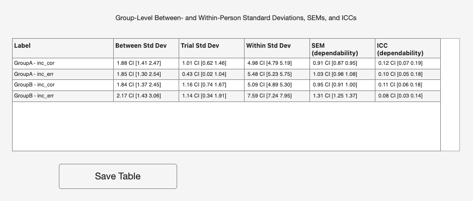

Three of those labels change on a subject-level run. Plot: Trials vs
Reliability becomes Plot: Subject-Level Reliability, Plot: ICC Estimates becomes
Plot: Subject-Level ICC Estimates, and Table: Trial Cutoffs at Reliability
Threshold becomes Table: Subject-Level Reliability. The change is not cosmetic.
A subject-level analysis estimates a per-participant residual, so a curve
projecting the group's reliability over trial counts is not a quantity it
produced, and the toolbox offers the per-participant outputs instead. On split
data every "Trials" in these labels reads "Splits".

On a subject-level run Table: Sources of Variance opens nothing of its own.
The group-level standard deviations, SEMs, and ICCs appear in the window that
Table: Subject-Level Reliability opens, whose buttons read Save Group-Level
Estimates and Save Subject Coefficients.

One analysis keeps the trial-cutoff table as well. On the subject-level
difference-score analysis the trial-cutoff table still opens alongside the
subject-level outputs, and this screen offers no control over it: the
relabeled checkbox governs the subject-level table instead, so the table
appears whenever results are viewed here. Its contents there are observed
quantities rather than projections. The per-event rows report the smallest
trial count among the participants that event included at the threshold (or
across everyone, when that event included nobody), next to the group-level
coefficient. The diff score row reports the observed-design difference
coefficient with a `---` placeholder in its count column, because this
analysis runs no trial-cutoff search.

Six buttons run along the bottom:

- Back to Home
- Open Another .psyrat File
- Generate Figures/Tables
- Output Prefs
- Criterion Score Outputs
- Close PsyRAT Outputs

Generate Figures/Tables draws everything you checked, each in its own window.
Close PsyRAT Outputs closes those windows and leaves your own MATLAB figures
alone, which matters after the fourth or fifth pass through different settings.

Criterion Score Outputs is the one button that is not always there. It appears
only for a plain one-facet analysis whose estimated universe-score mean is
available. Subject-level analyses and one-facet difference scores do not show
it, and neither does a view built from a DoD model that parameterizes a per-cell
log mean instead of an observed-scale mean. When it is absent the row closes up
and shows five buttons, which is the suppression working rather than a rendering
fault. [Section 9.7](#97-criterion-score-outputs) covers the screen it opens.

Entering a reliability cutoff that is not numeric or not between 0 and 1 turns
on a red line under the box reading "Reliability cutoff must be numeric and
between 0 and 1 (inclusive)" and returns the cursor to the field. Nothing is
generated until you fix it.

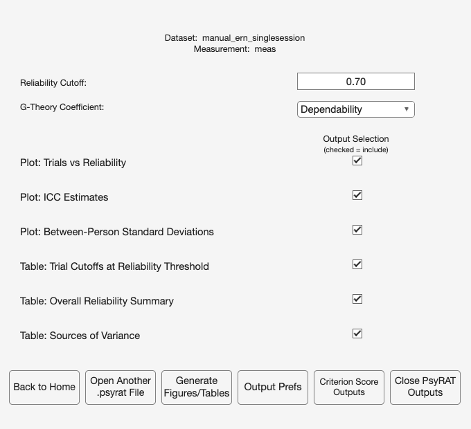

## 9.3 Test-retest results

The two-facet viewer carries the same title, View Results Setup, and the same
Reliability Cutoff, G-Theory Coefficient, output checkboxes, and buttons. Read
[Section 9.2](#92-single-session-results) first. What follows is what
test-retest adds.

- Type of Reliability Coefficient: which coefficient to report. Equivalence is
  the internal-consistency coefficient, Stability is the test-retest
  coefficient, and Equivalence + Stability combines both. The default is
  Equivalence.
- Test-Retest Occasion Score: whether the reported coefficient describes a
  score from one occasion or a score averaged over several. The choices are
  Single-occasion (n'_o = 1) and Multi-occasion composite (n'_o = k).
- \# Occasions in Composite (k): how many occasions the composite averages.

The three coefficients are not near-neighbors, and on real data they can differ
by more than the gap between an acceptable result and an unusable one. Choose on
the basis of the score you actually intend to use, then name the choice in your
write-up. The exported provenance block records it, so a saved table is
unambiguous even when the manuscript is not.

The occasion control needs the same care. Single-occasion is the toolbox's
default estimand: the reliability of a score from one session, generalizing over
the occasion facet. Multi-occasion composite reports the reliability of a score
averaged across k occasions, which is a different quantity and almost always the
larger of the two. Use it when your analysis really does average across
sessions. Do not use it to make a single-session score look better than it is.

The k box is enabled only when Multi-occasion composite is selected, and grays
out again the moment you switch back. It defaults to the number of occasions in
your data. A blank, fractional, or negative entry falls back silently to that
observed count rather than erroring, so check what you typed if a composite
result looks unfamiliar.

Two-facet difference scores add a fourth control, Difference-Score Coefficient,
choosing dependability or generalizability for the difference itself. It is
independent of the per-condition G-Theory Coefficient above it.

The test-retest screen also shows two subject-level plot options and a
subject-level table (Plot: Subject-Level Reliability, Plot: Subject-Level ICC,
and Table: Subject-Level Reliability), inserted after Plot: ICC Estimates and
before Plot: Between-Person Standard Deviations, for nine checkboxes in all.
These three produce output only on subject-level test-retest data (analysis
25). On every other test-retest result they are shown, enabled, and checked,
and Generate Figures/Tables draws nothing for them, so do not wait for a
window that is not coming.

Subject-level test-retest data gate five of the other outputs. On such a run,
Plot: Trials vs Reliability, Plot: ICC Estimates, Plot: Between-Person
Standard Deviations, Table: Trial Cutoffs at Reliability Threshold, and Table:
Overall Reliability Summary are unchecked and disabled, and hovering over any
of them shows the reason: "Not available for subject-level test-retest data:
this design estimates a per-participant residual, not the group-level
reliability, ICC and variance terms this output needs." The subject-level
outputs stay on. The five are disabled rather than left checked and silently
skipped, so you can see before you click which outputs this design produces.
A gamma run of this design (analysis 25) also shows a short Restricted note
under the Measurement line, pointing to the export header that carries the
full Section 5.4 disclosure, and its two subject-level plots carry a similar
note above their panels ([Section 9.5](#95-dynamic-reliability-results)).

Criterion Score Outputs appears on the test-retest screen only for the plain
test-retest analysis. On subject-level test-retest data and on two-facet
difference-score data the button is not offered, because the cut score
computation needs group-level components those designs do not estimate; the
row closes up to five buttons, the same behavior the single-session viewer
shows for its subject-level and difference designs
([Section 9.2](#92-single-session-results)).

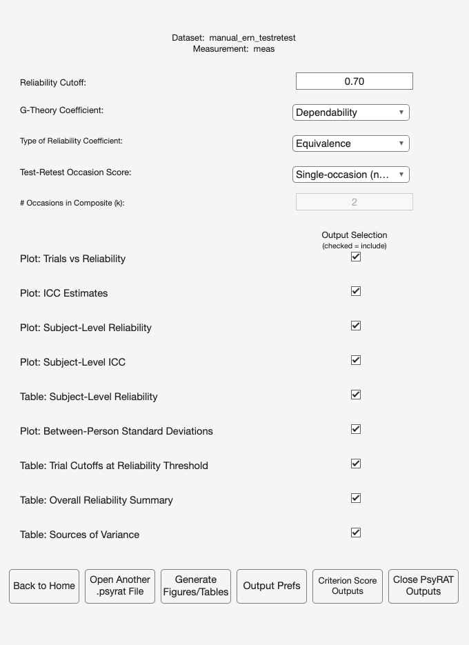

## 9.4 Difference-of-differences results

DoD results open a screen titled DoD Reliability Setup, and it works differently
from the two above. There are no output checkboxes. Each button produces one
kind of output directly.

Under the dataset and measurement lines, the screen states the contrast form it
will build: (ERP_1 - ERP_2) - (ERP_3 - ERP_4). Everything else on the screen
fills in that expression.

- Group: which group the contrast is evaluated in. Shown as a popup when there
  is more than one group, and as the fixed text "Group: none" otherwise.
- Heatmap metric: Dependability or Generalizability, for the two heatmaps only.
- ERP_1 through ERP_4: four popups assigning one event to each slot of the
  contrast.
- Trials for ERP_1 through Trials for ERP_4: four boxes giving the trial count
  each slot is evaluated at.
- Heatmap trial grid min: fixed at 0 and shown for reference.
- Heatmap trial grid max: how far the two heatmap axes extend. It defaults to
  the selected group's largest recorded trial count plus 25.

The four ERP popups default to the mapping you declared during processing when
the file records one, and the four trial boxes default to the rounded mean
recorded trial count for the selected group. Those trial defaults describe your
data, so they are a reasonable starting point, but they are editable because the
interesting question is usually what a different design would buy you.

The four slots must name four different events. Repeating one raises a dialog
titled DoD mapping requires four unique events. Trial counts and the grid
maximum must be whole numbers of at least 0, and the grid maximum must not
exceed 300, since the heatmaps evaluate the coefficient at every cell of a
square grid and a larger one takes long enough to feel broken. If your data
hold more than 275 trials in any event, that default is over 300, and Generate
DoD Outputs raises a dialog titled Heatmap grid too large until you lower it.

A line above the buttons states a difference you should carry into your
reporting: heatmaps use posterior mean variance components for speed, and the
summary table uses posterior draws. The table gives you a coefficient with a
credible interval from the full posterior. The heatmaps give you a fast map of
point estimates evaluated at a single plug-in value of each variance component,
with no interval anywhere on them. Read a heatmap for shape and the table for
numbers. Quoting a heatmap cell as a point estimate with the table's interval
attached would be wrong.

Eight buttons run along the bottom:

- Back to Home
- Open Another .psyrat File
- Generate DoD Outputs
- Other Single-Session Metrics...
- Observed DoD Table
- Export DoD Var Components
- Refresh
- Close PsyRAT Outputs

Generate DoD Outputs opens one window titled DoD Reliability Outputs. It holds
the group, the contrast written out with your event names, the trial counts you
entered, the heatmap metric, a summary table of both coefficients with credible
intervals and ICCs, and the two heatmaps. The ICC columns are computed at a
single observation, which the window says on its face, so they do not move when
you change the entered trial counts. If any entered count is 0, a red line notes
that summary reliability is reported as 0 for that reason.

The window states, between the table and the heatmaps, what each kind of
number is. Every heatmap cell is a plug-in coefficient: the ratio formed from
the posterior mean of each variance component, with no interval. The table is
the mean of the draw-level coefficients, with its credible interval. Those are
different summaries of the same posterior and can differ; two equally weighted
draws with universe-score variances of 1 and 9 against an error variance of 1
give .70 for the table and .83 for the plug-in cell at the same counts.
Neither is wrong under its own label. Do not present a heatmap cell as the
table's estimate or the reverse.

The table's warning is on the window. The dialog described at the end of this
section, Coefficient is not interpretable as a reliability, is transient, so
the window carries the warning as well. When any quantity that must be a
variance was negative in any posterior draw at the entered counts, a red line
reading Table warning sits under the estimand note and is saved with the
window. It is the same check the dialog makes, and it is separate from the
gray cells: the gray mask is
a deterministic check at the component means, while the table's warning counts
draws. The two can disagree. Trial-contrast draws of -.5 and 1.5 in equal
proportion have a valid mean of .5, so every heatmap cell is drawn, while the
table's coefficient is not interpretable because half the draws were negative.
Read the table's warning for the table and the gray cells for the heatmaps.
A table built at a zero entered count is the 0-by-convention stand-in, carries
no draws and no such warning, and the red zero-count line says so.

A heatmap cell is drawn gray, over the parula colors, when it cannot be read
as a reliability. The check is the one the table's own warning uses, applied at
that cell's trial counts: the universe-score contrast variance, the between-trial
contrast variance projected to those counts, the residual contrast variance,
and the between-trial contrast variance at a single observation must each be
finite and at least zero. A cell is also gray when its denominator is at or
below zero or its coefficient falls outside [0,1]. A coefficient inside [0,1]
does not by itself make a cell valid: with a between-trial block whose two
events correlate strongly, unequal counts such as 1 and 100 trials can drive the
projected between-trial contrast variance below zero while the dependability
still comes out at .33, and that cell is gray. The projection at unequal counts
divides the cross-event covariance by the harmonic mean of the two counts, which
is what lets that quantity leave the space of variances; the same block at
equal counts is fine. The check applies to the evaluation whichever metric you
chose, so a negative between-trial contrast variance grays a Generalizability
cell too, even though that term is not in the generalizability denominator. The
rule is the strict computed sign with no tolerance: a value of exactly zero is
a legitimate boundary, not a fault. Cells on the zero row or column show 0 by
convention and are not computed. Nothing is clipped, rounded, or replaced; the
caption under the heatmaps names the rule.

The DoD Reliability Outputs window has no export button of its own. If you
save it as a MATLAB figure (File > Save As with the .fig type, or `savefig`),
the saved figure keeps the full grid record alongside the drawing. That record
holds every cell's raw value, the four variance quantities behind it, its
denominator, whether it was drawn, and the reason it was not, together with
the counts, mapping, group, metric, and posterior-mean components the grid was
built from. It also keeps the table's
raw draw-level results as computed, the entered counts they were computed at,
the full text of the table's admissibility note, and whether that note reports
an invalidity. Saving or exporting the window as an image keeps only the
rendered picture: its gray cells, the captions, and the Table warning line. For
readers who want the numbers, the records are the `dodgrid` and `dodtable`
fields of the figure's `UserData` (`get(gcf,'UserData')` with the reopened
figure current); `dodgrid.heat` holds one entry per heatmap, and
`dodtable.dep` and `dodtable.gen` are the table's results with their draws.
The Observed DoD Table and Export DoD Var Components outputs described below
are draw-level summaries, not exports of the heatmap grid. A figure or image
that an earlier version of PsyRAT saved from this window kept the coefficient
and lost the warning, and its heatmaps could show an inadmissible cell painted
as 1.0 and an out-of-range value painted at 0 or 1. Regenerate such a figure
from the saved result; no refit is needed.

Observed DoD Table opens a window titled Observed Difference-of-Differences
Reliability, holding one row evaluated at the mean recorded trial counts rather
than at whatever you typed. It has its own Save Table button. Use it as the
description of the design you ran, and the main outputs as the description of
designs you might run.

Export DoD Var Components goes straight to a save dialog. No window opens
first. It writes the DoD contrast variance components with point estimates and
credible intervals, then the two coefficients and their ICCs, at the observed
mean trial counts.

Refresh rebuilds the screen from the current selections and resets the four
trial counts to the selected group's defaults, which is how you get the trial
defaults to follow a group change. The ERP mapping, the heatmap metric, and the
grid maximum are kept as selected.

Other Single-Session Metrics... opens a small window titled DoD: Other
Single-Session Metrics. It routes one group's DoD model into the standard
single-session outputs. Mode offers Single-event reliability or 2-event
difference reliability; Event 1 is always shown, and Event 2 appears only in
difference mode. Open Standard Output GUI builds the requested view and hands it
to the single-session viewer described in
[Section 9.2](#92-single-session-results). Two different events are required in
difference mode.

If any quantity that has to be a variance came out negative, a dialog titled
Coefficient is not interpretable as a reliability appears after the output is
drawn. Nothing was clipped or adjusted to produce the numbers on screen. The
dialog explains them. A coefficient reported under that warning is not a
reliability and should not be reported as one.

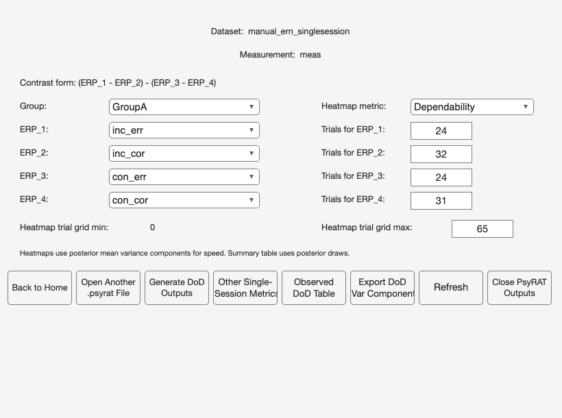

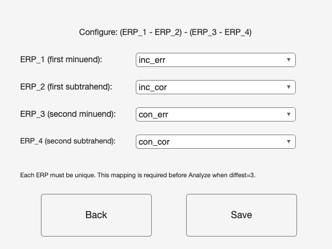

## 9.5 Dynamic reliability results

Dynamic reliability results open a screen titled Dynamic Reliability: View
Results. Under the dataset line it lists the standardized dimensions the surface
is drawn over. Like the DoD screen, it has no output checkboxes.

- Coefficient: Generalizability G(z) or Dependability D(z). The default is
  Generalizability G(z).
- Trials n' (blank = per-group median): the trial count the surface is
  evaluated at. Left blank, each stratum uses its own median.
- Credible interval (0-1): the interval width, defaulting to 0.95.
- Reference cutoff (blank = none): a reliability value to mark on the figure.
  Left blank, nothing is drawn.
- Estimand: Typical person (delta_p = 0) or Population average (lognormal).
  On a gamma run the two choices are instead Population-marginal surface
  (primary), the default, and Typical-person surface (zero person effects);
  see Section 15.2 for what each one is.

I would keep the blank defaults on a first pass. A per-stratum median describes
each stratum's own data instead of imposing one count on all of them, and the
export header labels it as the default. The Estimand choice never changes the
per-participant table.

The Estimand control is enabled only for the non-difference variants. On every
difference variant it is grayed out, because only one surface is computed
there. Under the Gaussian family, and for the four-event contrasts of analyses
28 and 29, that surface is the typical-person reference, and no
population-average difference estimand is computed. Under the gamma family the
two-event difference designs report the population average over person
dispersion (log-nu) or over person residual-SD heterogeneity (location-scale),
and the export header names which. That disabled control is the toolbox
declining to imply a choice it does not offer.

Two-facet dynamic designs add two controls:

- Reliability coefficient: Equivalence (occasion fixed), Stability (trial
  fixed), or Equivalence + stability (both random). The default is the third.
- Occasions n': 1 occasion or Observed occasions. The default is 1 occasion.

The buttons sit two to a row. Plot reliability surface draws the figure. Show variance
components opens a table of per-stratum components with credible bounds. Save
variance table (CSV) exports it. Done closes the viewer. Back to Home and Open
Another .psyrat File sit at the bottom. Subject-level variants add Show
per-participant table and Save per-participant table (CSV), giving each
participant's own coefficient at their own dimension value.

The save buttons say CSV, and both offer Excel file (\*.xlsx) first with CSV
second. The label is narrower than the behavior: a name ending in .xlsx gets a
checked workbook, and any other name gets CSV text. Either format writes the same
header, naming the credible interval, the estimand, and the n' each stratum's
surface was evaluated at, with the n' line saying whether that came from your
override or from the per-stratum median default. That last line matters more
than it looks: without it, an override is invisible in the file.

Some designs disclose an extra line on screen, under the variance-components
table, and it belongs in any write-up of those results. A modular cut-posterior
run states that the copula residual correlation is estimated conditionally on
the retained margin draws with no copula feedback, so its intervals are not
full joint-posterior credible intervals. A nonconcurrent
difference-of-differences run states that the four constituents are treated as
if measured on distinct trials, with all six conditional residual covariances fixed to zero by
assumption, and that the result is neither a concurrent reliability nor a cut
posterior. Both notes point at the exported header for the full provenance.
Neither appears for designs it does not apply to. On a gamma subject-level run
of analysis 26 or 27, the per-participant window carries a note of its own
under its table. It names the surface target, what each participant's
coefficient conditions on, and the residual scheme; a result carrying the
older observation-only scheme, whether unstamped or explicitly requested, is
reported as LEGACY rather than as the current scheme
([Appendix C](appendix-c_reprocessing.md)). A further note sits in the
viewer's main window rather than under a table: a gamma run of analysis 14,
25, or 27 (the three Restricted two-facet designs) shows a short form of the
Section 5.4 disclosure under the Dimensions line (dynamic viewer) or the
Measurement line (test-retest viewer). The note points to the export header,
which carries the full statement. On such a run, the surface figure of
analyses 14 and 27 and the two subject-level plots of analysis 25 carry a
figure-length form of the note above their panels, so a saved PNG, PDF, or
FIG keeps it.

The surface figure carries its own Save figure (PNG/PDF) button in the bottom
left corner. The button hides itself while the image is written, so it does not
appear in the saved file.

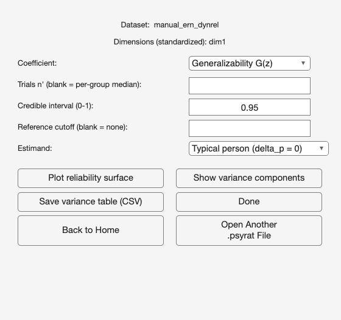

## 9.6 Data-splits results

Nonparallel data-splits results open a screen titled Data-Splits Reliability:
View Results. Under the dataset line sit two banners. On the single-occasion
design (analysis 23) the first names the analysis unit and states that each
score is the mean of n_i items, and the second is the caveat that design turns
on:

> Dependability is exact; generalizability is a downward-biased lower bound.

On the multi-occasion design (analysis 24) the first banner instead reads
"Nonparallel splits: available occasions / count projection" and the second
reads "D is conditional on score/model; G uses the conventional relative
partition."; the paragraphs after the settings list say what that means.

The single-occasion sentence is the toolbox's documented convention, and its reason is worth
understanding rather than memorizing. When the input is split means rather than
single trials, the only thing the model observes is the split-level score. The
item-level partition inside each split is gone, so the item main effect cannot be
separated from the residual and collapses into the split-level error term.
Absolute error already includes that item variance, so dependability is
unaffected and exact. Relative error is supposed to exclude it and here cannot,
so the relative error variance is too large and the generalizability coefficient
it produces is too small. The reported value is therefore a lower bound on the
true generalizability, and the relative SEM correspondingly an upper bound. The
generalizability-theory framework this rests on is developed in Rocha et al.
(2026); the bound statement is the toolbox's convention for reporting what a split-mean design can
and cannot identify.

The practical rule on the single-occasion design: quote dependability as an
estimate and generalizability as a bound, in those words. The column headers
help, since the coefficients table names its columns Dependability and
Generalizability (lower bound), with SEM (abs) and SEM (rel, upper bound)
beside them. With unequal split counts per participant, the coefficients use
each participant's own counts, the reported number of splits is the harmonic
mean of the counts, and the note under the table adds that the relative
coefficient's exclusion of the split main effect is then approximate.

The multi-occasion design reads differently, and the lower-bound rule does not
apply to it. Its coefficient columns are Dependability, Generalizability
(conventional), SEM (abs) and SEM (rel, conventional). Dependability is exact
conditional on the score the design fits, the equal-weight mean of each
participant's available occasion means, and generalizability uses the
conventional relative partition, with no bound and no bias guarantee asserted.
Quote it as a conventional estimate, and quote the design note the exports
carry with it ([Chapter 13](13_tutorial-splits.md), Section 13.6).

Three settings:

- Credible interval (0-1): the interval width, defaulting to 0.95. On a native
  fitlme result the control reads Bootstrap interval (0-1), because those
  intervals are a parametric bootstrap.
- Splits n' (blank = observed design): the number of splits per person the
  coefficients are reported at. Blank uses each stratum's observed design: the
  common count, or the harmonic mean of the counts when participants contribute
  different numbers of splits (the coefficients then use each participant's own
  counts). On the multi-occasion design the box is labeled Splits n' projection
  (blank = observed): blank reports the observed design, with the rounded
  median split count shown as a reference count in the n splits (reference)
  column, and a number reports a balanced reference-design projection,
  labeled as one.
- Occasions n' projection (blank = observed): the number of occasions, shown
  only for the multi-occasion design; a number here is the same kind of
  balanced projection.

Five buttons: Show coefficients, Show variance components, Save coefficients
(CSV), Save variance table (CSV), and Done (on the multi-occasion design the
two save buttons read Save coefficients and Save variance table). As on the
dynamic screen, the save dialogs offer Excel file (\*.xlsx) first and CSV
second despite the labels, and a name ending in .xlsx gets a workbook while
any other name gets CSV text.
On the multi-occasion design, each export also writes one header line per
stratum describing its observed design, and with many participants and splits
that line can outgrow an Excel cell: a design of 60 participants, 2 occasions
and 10 splits already produced about 33,700 characters, over the 32,767 a cell
holds. The .xlsx save then stops with a File Not Saved dialog and leaves any
existing file unchanged, while the .csv save keeps every design line whole
([Section 9.1](#91-what-every-viewer-has-in-common)).

There is no reliability-versus-trials plot here and no trial-cutoff table,
because there is no projection over item counts to draw. Unequal items per
split make the splits nonparallel, and a projection over hypothetical item
counts would require the item-level partition that split means discarded. Left
blank, the viewer reports the observed design: the coefficients, their SEMs,
and the variance components, at the split and occasion counts your data have.
The Splits n' and Occasions n' boxes are the only projections offered, and
they hold the items per split fixed. A projection over trial counts needs
single-trial input, which is the analysis
[Chapter 10](10_tutorial-single-session.md) runs.

The coefficients window repeats the design's note under the table, and every
export writes it into the header, so the caveat travels with the numbers.

This screen has no Back to Home or Open Another .psyrat File button. Done closes
it and returns you to the MATLAB prompt; run `psyrat_start` for the home screen.

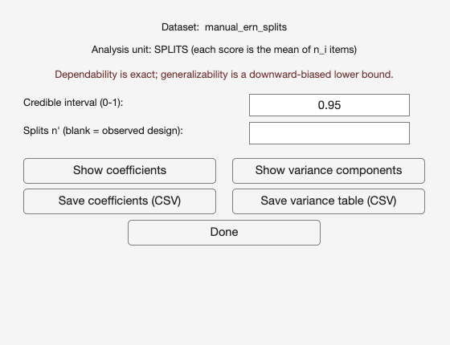

## 9.7 Criterion Score Outputs

Everything above evaluates reliability for relative decisions or for absolute
ones against the whole scale. Criterion Score Outputs evaluates it against a
specific score. If your question is whether a participant falls above or below
some value, the relevant quantity is reliability at that value, and it is not
the same number as the overall coefficient.

The Criterion Score Outputs button on the single-session or test-retest screen
opens Criterion Score Outputs Setup. Its top rows show the dataset and the
measurement.

- Criterion Cutoff: the score threshold to evaluate. This is a value on the
  measurement scale, in microvolts or whatever your measurement column holds,
  and it is not a reliability threshold.
- Decision Coefficient: Dependability (Absolute). Fixed text, not a control.
- Average Score (mu): the fitted model mean, averaged with equal weight over
  the groups and events of the loaded result and shown to four decimal places.
  Also fixed text.
- Type of Reliability Coefficient: Equivalence, Stability, or Equivalence +
  Stability. Shown only when the results are test-retest.

Then two checkboxes under the Output Selection heading, both on by default:

- Plot: Trials vs Reliability at Criterion
- Table: Overall Reliability Summary at Criterion

Then three buttons: Back to Results Setup, Generate Criterion Outputs, and
Close PsyRAT Outputs.

The Criterion Cutoff box opens at 0, not at the mean; the displayed mu is the
fitted model mean, and it marks the worst case. The
criterion coefficient adds the squared distance between the mean and the cut
score to both the numerator and the denominator, so a criterion sitting exactly
at the mean adds nothing and reduces to the ordinary dependability, and every
criterion further out returns a higher value. Enter the value your decision
actually uses, and do not read either the 0 default or the displayed mean as a
recommendation. A non-numeric entry turns on a red line reading "Criterion
cutoff must be numeric" and nothing is generated.

Dependability is not a choice here, and the fixed wording is not an oversight. A
cut score is an absolute decision by construction, so the relative coefficient is
not a valid quantity for it, and the screen does not offer it. On test-retest
data the criterion outputs are computed at one occasion, and the
windows say so on their face. The route is offered only for the designs that
estimate the components it needs: the plain one-facet analysis and the plain
test-retest analysis. The subject-level and difference-score designs do not
show the button ([Section 9.2](#92-single-session-results) and
[Section 9.3](#93-test-retest-results)).

If a row of the criterion summary retains no participant, its trial summaries,
its dependability, and the interval show dashes, while n Included and n
Excluded stay numeric, and the exported table keeps the underlying values with
a note saying they are full-sample references. Mu is always labeled as the
fitted model mean. The curves are model projections, and the Extrapolation
beyond data warning, when it appears here, concerns the D-study trial cutoff,
not the criterion score.

Criterion Score Outputs is available only through the GUI. There is no scripted
equivalent: `psyrat_run` and the headless report writer described in
[Chapter 14](14_scripting.md) produce no criterion outputs, and no argument
turns them on. If you need criterion results in a reproducible pipeline, the
honest workflow is to generate them here, save the table, and record the
criterion cutoff you used. The exported header writes that cutoff to four
decimal places for exactly that reason.

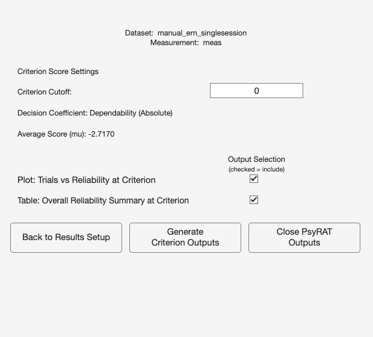

## 9.8 A gallery of output figures

Each figure below is described the same way: what the axes are, then what to
look for.

### Reliability versus trials

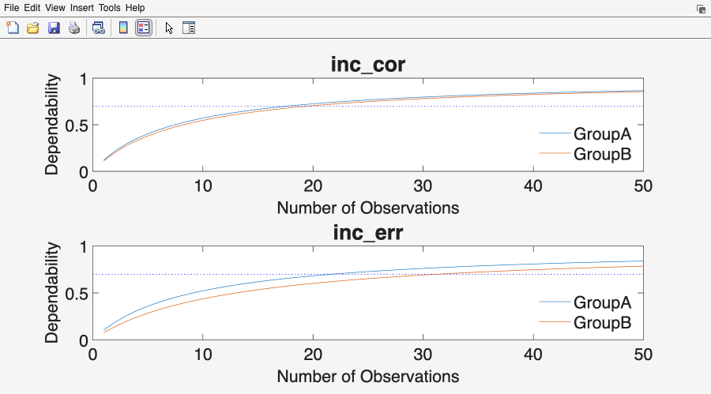

The x-axis is the number of observations, running from 0 to the plotting range
you set in View Preferences. The y-axis is the coefficient you selected,
dependability or generalizability, on the full 0 to 1 scale. One curve is drawn
per group, labeled by a legend when there is more than one, and one panel per
event. The dotted blue horizontal line is your Reliability Cutoff. The curve
itself is whichever posterior summary you chose, so a plot of the lower limit
sits below a plot of the point estimate throughout.

Read where the curve crosses the dotted line, and how steeply. The crossing is
the trial count the trial-cutoff table reports, but only when Line to plot for
reliability and Estimate to use for trial cutoffs are set to the same summary.
They are separate preferences, and with the line on the point estimate and the
cutoff on the lower limit the table will report a larger trial count than the
crossing you see. A curve that crosses early and then flattens says the
design has headroom, and collecting more trials will not move reliability much.
A curve still climbing steeply at the right edge says the opposite, and it also
says your plotting range is too short to answer the question. A curve that
never reaches the line within the plotted range may only need a longer range
in View Preferences, since the cutoff search runs well past the plot, to the
largest observed trial count plus 1,000. If no trial count in that range
reaches the threshold, the table shows the -1 case from
[Section 9.1](#91-what-every-viewer-has-in-common), and the Cutoff not
calculable dialog appears.

### ICC estimates

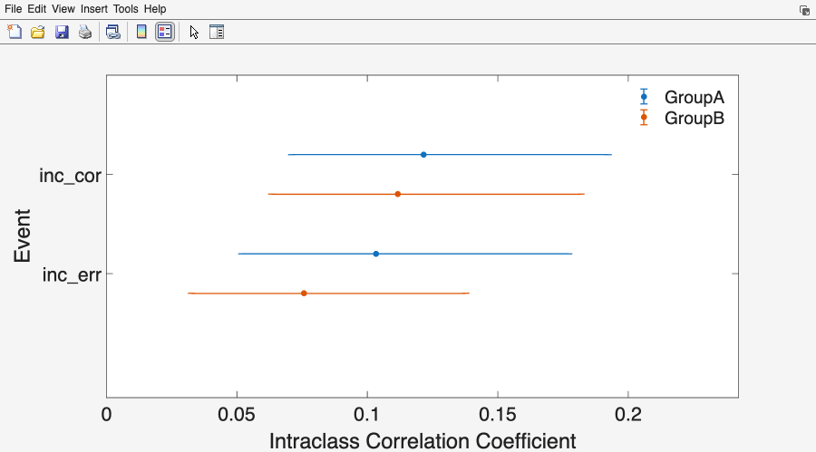

Events are listed down the left, one row per event with one series per group,
and the intraclass correlation coefficient runs along the bottom. Each point is
a posterior point estimate and the bar through it is its credible interval.

Read the intervals before the points. A tight interval well away from zero says
the between-person variance is estimated precisely and the measure separates
people. A wide interval means the data did not pin the ICC down, and the point
estimate on its own would mislead. Comparing groups, do not read a difference
from the points alone, and do not read equality from overlapping intervals:
that question concerns the posterior of the difference, which this figure does
not show ([Chapter 4](04_gtheory.md)). The figure is not a test, and a gap
between two point estimates is not a group difference.

### Between-person standard deviations

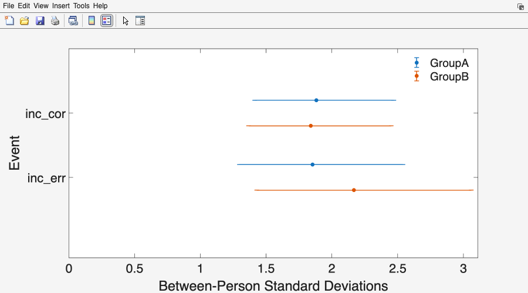

Same layout as the ICC figure. Events are listed down the left and the
between-person standard deviation runs along the bottom, in the units of your
measurement.

Reading this alongside the ICC figure usually explains a disappointing
coefficient. Reliability can be low because within-person error is large or
because between-person differences are small, and those call for different
responses. A small between-person standard deviation with a tight interval says
the sample is homogeneous on this measure, and no number of extra trials will
fix that. The within-person standard deviations that complete the picture appear
in the Sources of Variance table rather than as a plot.

### Subject-level reliability

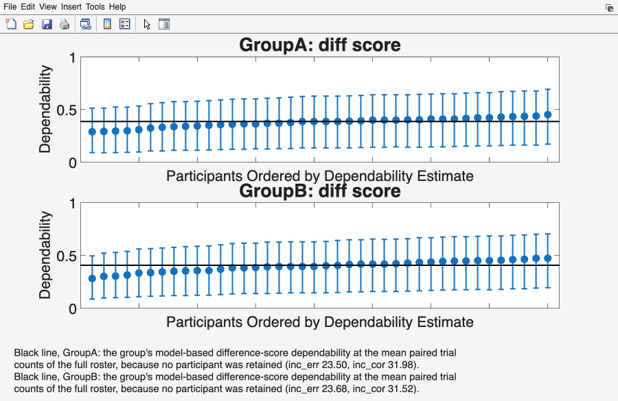

One panel per stratum (per group, per event, or both). The x-axis is
participants, ordered by their own estimate, with the tick labels suppressed
because the ordering carries the information. The y-axis is the subject-level
coefficient on the 0 to 1 scale. Each participant is one point with a credible
interval. The solid black horizontal line is the group-level estimate, and
participants whose interval excludes that line are drawn in red. On a
subject-level difference-score run the line is the group's difference-score
coefficient from the group-level model (on the ICC plot, its difference-score
ICC at one observation per event), and a caption on the figure states the
trial counts it was evaluated at; [Chapter 15](15_advanced-designs.md)
explains the choice.

The color coding is the thing to read. When any participant's interval fails to
cover the group estimate, the plot splits: those participants are drawn in red
and the rest in blue. When every interval covers the group estimate, no split
occurs and the points are drawn in the default single color. So red marks
participants whose reliability is credibly different from the group's, and a
figure with no red at all is a figure saying the group estimate describes
everyone reasonably well.

Beyond the colors, look at the spread. A near-flat band of points across the
line is the picture of a homogeneous sample. A long tail of red at the low end
identifies specific participants whose scores carry more error than the group
number implies, which is a screening result, not a diagnosis. The companion
subject-level ICC plot has the same layout with ICC on the y-axis.

### Dynamic reliability surface

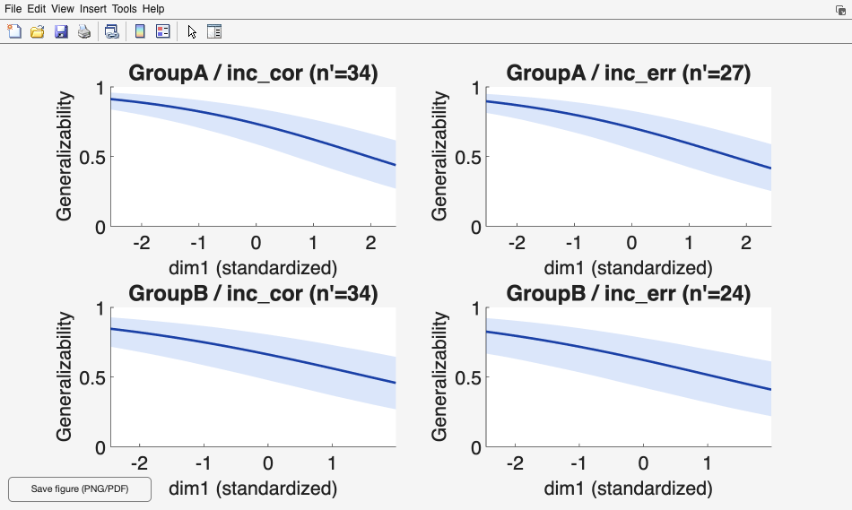

With one dimension, the x-axis is that standardized dimension and the y-axis is
the coefficient from 0 to 1. A solid line is the point estimate, the shaded band
around it is the credible interval, and a dotted blue horizontal line marks the
Reference cutoff if you set one. With two dimensions the figure becomes a filled
contour over both standardized predictors, with the coefficient on the color
bar and the reference cutoff drawn as a white contour. One panel per stratum,
titled with the stratum label and the n' the surface was evaluated at. On a
subject-level variant each participant also appears as a point at their own
dimension value, orange against the curve in one dimension and colored on the
same scale as the contour in two. On a gamma run of a non-difference design
(analyses 11, 14, 26, and 27) the figure also carries a caption along its
bottom edge naming the surface target (population-marginal primary or
typical-person companion), the parameterization, and the source of the
surface n', and, on a subject-level run, what the participant points
condition on. The caption is part of the figure, so a saved PNG or PDF keeps
it.

Read the slope first. A surface that is flat across the dimension says
reliability does not depend on it, which is the assumption every ordinary
coefficient makes. A surface that falls off at one end says the measure works
better for some people, or in some conditions, than in others, and a single
pooled coefficient is averaging over a real difference. Then read the band. A
surface that slopes within a wide band has not established that dependence.
Where a reference cutoff is drawn, the region of the dimension on the wrong side
of it is the part of your sample the measure does not serve, and that is a
sample-composition finding worth reporting.

### Difference-of-differences heatmaps

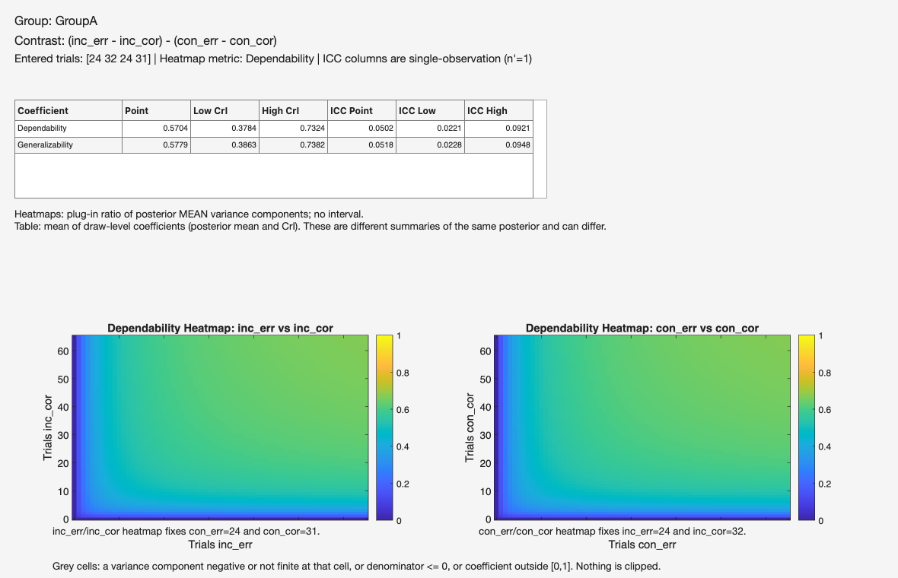

Two heatmaps sit side by side under the summary table. On the left, the axes are
the trial counts of ERP_1 and ERP_2, with the trial counts of ERP_3 and ERP_4
held fixed at the values you entered. On the right, the reverse. Both run from 0
to your Heatmap trial grid max. Color is the selected metric, dependability or
generalizability. Both color bars span 0 to 1. Cells with invalid components,
invalid denominators, or coefficients outside that range are gray; raw values
are retained without clipping. A caption under each panel names the counts
held fixed.

Read the gradient direction. Where the color changes fastest is where extra
trials buy the most, and that is rarely symmetric: a rare condition usually
dominates one axis. A plateau in the upper right corner tells you the design
saturates, so the additional trials you were considering would be spent for
almost nothing. Use these to choose a design, then take the coefficient and
interval from the summary table above them, since the heatmaps carry point
estimates from posterior means and no intervals at all.

### Reliability at a criterion score

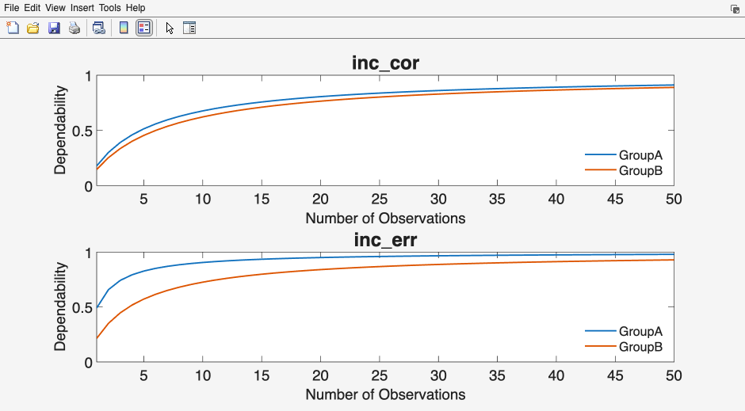

The x-axis is the number of observations and the y-axis is dependability at your
criterion cutoff, from 0 to 1. One curve per group, one panel per event. The
window title records the criterion cutoff to three decimal places, and it adds
"- model projections" when any group retained nobody, a trial cutoff lies
beyond the observed counts, or a full-sample reference was used. Keep the
title in the screenshot when you circulate one.

Compare this curve against the corresponding reliability-versus-trials figure
rather than reading it alone. The criterion curve can never fall below the
ordinary dependability curve; it meets it when the cut score equals the mean
score and rises above it as the cut score moves away. So a criterion curve
sitting barely above the overall curve is telling you that your cut score falls
near the middle of the distribution, which is the hardest place to classify
people reliably. That is a finding about your decision rule rather than about
your data quality, and moving the cut score is a legitimate response to it.

### Trace plots

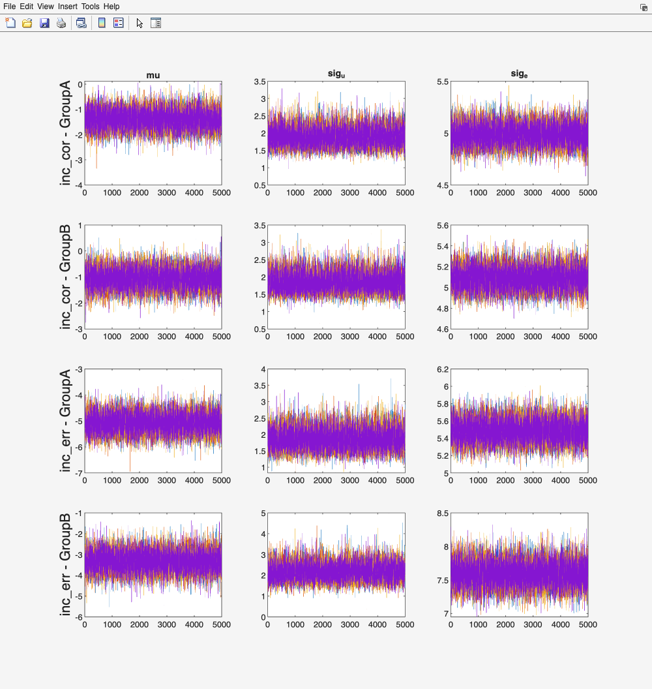

Trace plots belong to the processing stage rather than to any viewer. They
appear at the end of a plain one-facet run (not a subject-level or
difference-score run, and not a fitlme fit) when the trace-plot preference is
on, and [Chapter 7](07_processing.md) covers the prompt that offers them. They are
included here because they are the figure you will want when a viewer greets you
with the Estimation diagnostics notice.

The x-axis is the number of samples and the y-axis is the sampled value of one
parameter, with one row per group-and-event cell and one column per parameter
(the mean mu, then the between-person and within-person standard deviations,
sig_u and sig_e), and all chains overplotted in each panel.

What you want is dense, stationary, thoroughly mixed noise with the chains
indistinguishable from one another. That is, these plots should look like
what Lunn et al. (2012) describe as a fat, hairy caterpillar.
What you do not want is a chain drifting across the panel, a chain sitting in a
band the others never visit, or a slow wandering that never settles, all of
which mean the sampler has not converged and the reliability estimates built
from those draws should not be reported. More warmup and sampling iterations are
the first response. [Chapter 18](18_troubleshooting.md) covers the rest.

## 9.9 Where to go next

Reading these outputs scientifically, and reporting them in a manuscript, is
[Chapter 17](17_reporting.md). Producing the same tables without the GUI is
[Chapter 14](14_scripting.md). The four tutorials in Chapters 10 to 13 walk one
complete pass through the viewers for each of the main designs, with the numbers
you should expect to see.
